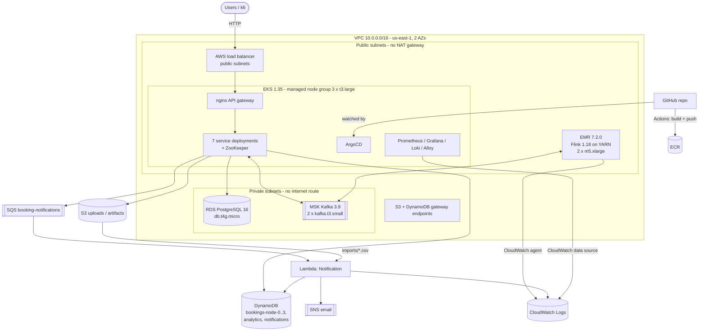
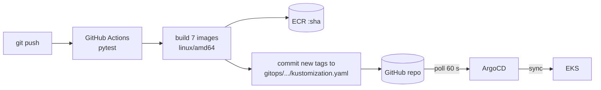
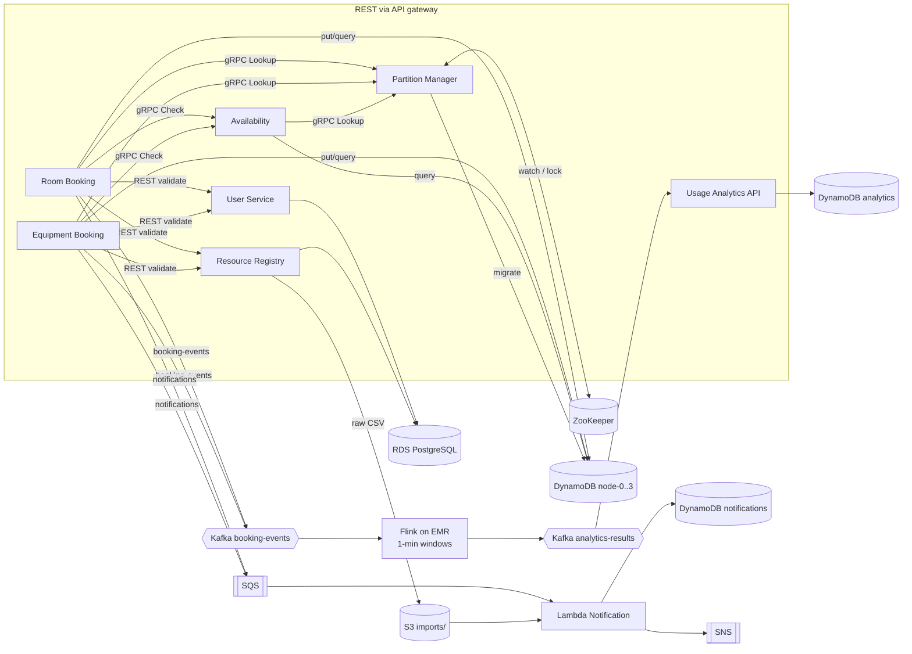
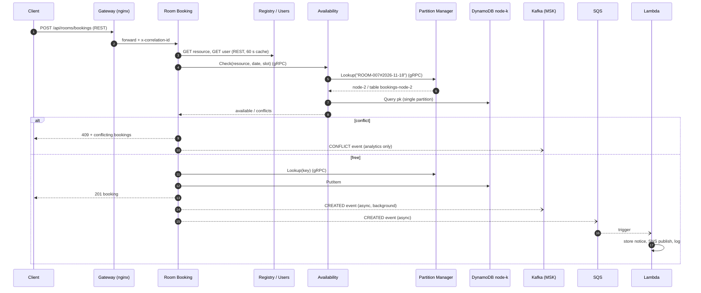

# Smart Campus Booking Platform: Design Document

**Course:** CS/SS G527 Cloud Computing, Semester I 2026-27 · **Scenario:** S4, Smart Campus (room and equipment booking across campus buildings) · **Concept:** data partitioning with consistent hashing · **Cloud:** AWS (us-east-1)

| Member | ID | Tasks | Services |
|---|---|---|---|
| Animesh Bhargava | 2026PHXP0098P | a, c, d, h | User Service, Resource Registry, Room Booking, Availability |
| Shreyansh Kedawat | 2022HS120897P | b, e, f, g | Partition Manager, Equipment Booking, Notification (Lambda), Usage Analytics (Flink) |

---

## 1. System overview

Students, faculty and staff book lecture rooms, labs and shared equipment (projectors, oscilloscopes, VR kits) across buildings (NAB, FD-I/II/III, LTC). The platform must:

* keep a registry of users (with roles) and bookable resources (with capacity, features, opening hours, availability flag);
* accept, modify and cancel reservations **without double-booking** a slot;
* store booking records in a store that scales horizontally, **partitioned with consistent hashing**, so storage nodes can be added or removed while moving only a small share of the data;
* notify users asynchronously when a booking is confirmed, changed or cancelled;
* compute real-time usage analytics (room occupancy, equipment utilisation, booking conflicts) over 1-minute windows;
* run on managed cloud services, provisioned entirely from code, deployed through GitOps, autoscaled and observable.

The system is decomposed into the eight microservices fixed by the scenario: User Service, Resource Registry, Room Booking, Equipment Booking, Partition Manager, Availability, Notification and Usage Analytics. Seven run as containers on Amazon EKS (including the serving side of Usage Analytics), the Notification Service runs on AWS Lambda, and the stream-processing part of Usage Analytics runs as an Apache Flink job on Amazon EMR. Their responsibilities are detailed in Section 4. Platform components that are not counted among the eight: an nginx **API gateway** (the public URL), **ZooKeeper** (coordination for the Partition Manager), and the observability stack.

## 2. Cloud deployment architecture

### 2.1 AWS topology

All resources live in one VPC in us-east-1 across two availability zones. Compute that needs to be reachable (EKS worker nodes, the EMR cluster, the load balancer) sits in public subnets protected by security groups; the data stores (RDS, MSK) sit in private subnets with no route to the internet. Serverless and regional services (DynamoDB, S3, SQS, SNS, Lambda, ECR, CloudWatch) are reached through AWS endpoints, with free gateway endpoints for S3 and DynamoDB.

### 2.2 Infrastructure as code

Everything in Figure 1 is provisioned with Terraform (`infra/`), one state in S3 with a DynamoDB lock:

| Module | Creates |
|---|---|
| `network` | VPC, 2 public + 2 private subnets, IGW, route tables, free S3/DynamoDB gateway endpoints |
| `eks` | EKS 1.35 (terraform-aws-modules/eks), managed node group, add-ons (VPC CNI, CoreDNS, kube-proxy, Pod Identity agent), IAM role for app pods + Pod Identity association, access entries for both members |
| `cicd` | 7 ECR repositories + lifecycle policy, GitHub OIDC provider, least-privilege CI role |
| `data` | RDS PostgreSQL (SG-to-SG rule from EKS nodes only), 4 DynamoDB partition tables + analytics + notifications tables, S3 buckets, SQS queue + DLQ, SNS topic, app IAM policy |
| `msk` | MSK cluster, configuration, SG (9092 from VPC only), broker logs to CloudWatch |
| `emr` | EMR service role + EC2 instance profile (instead of `aws emr create-default-roles`), managed SGs, CloudWatch-agent bootstrap action, Flink cluster |
| `lambda` | Notification Lambda (zip from source, `source_code_hash`), SQS event source mapping (partial batch), S3 notification, IAM, log group |
| `argocd` | namespaces, `platform-config` ConfigMap / `platform-secrets` Secret (endpoints of the TF-made resources), ArgoCD (Helm), the root app-of-apps |
| `observability` | CloudWatch log group for Flink, Grafana CloudWatch IAM role + Pod Identity, AWS Budgets alert |

`enable_msk` / `enable_emr` switch the expensive clusters on and off independently (`./scripts/emr.sh up|down`). No resource is created in the console. The only manual AWS step is upgrading the account to the Paid plan (an account setting, not infrastructure).

### 2.3 Deployment pipeline (GitOps)

* Terraform installs ArgoCD and **one** root Application; everything else is declared in Git (`gitops/root` app-of-apps → metrics-server, kube-prometheus-stack, Loki, Alloy, observability-config, smart-campus).
* CI authenticates to AWS with GitHub OIDC (no stored keys) and never touches the cluster. It only pushes images and commits the tag bump. ArgoCD auto-syncs with prune and self-heal: a manual `kubectl edit` is reverted, and a rollback is a `git revert`.

## 3. Microservices architecture diagrams

### 3.1 Service interaction diagram

Figure 3 shows every microservice, the data store each one owns, and the mechanism on every edge: REST for validation look-ups, gRPC on the booking hot path, Kafka and SQS for events, and S3 events for file uploads.

### 3.2 Booking request sequence

## 4. Microservice responsibilities

### 4.1 Responsibilities, compute and data ownership

| # | Service | Responsibility | Compute | Own data |
|---|---|---|---|---|
| 1 | User Service | campus users and roles (student/faculty/staff/admin); validates user ids for bookings | EKS | RDS PostgreSQL db `users` |
| 2 | Resource Registry | rooms, labs, equipment + availability attributes; bulk CSV import | EKS | RDS PostgreSQL db `resources`; raw CSVs in S3 |
| 3 | Room Booking | create / modify / cancel room and lab reservations | EKS + **HPA** | DynamoDB partition tables (via the ring) |
| 4 | Equipment Booking | same life cycle for equipment | EKS | DynamoDB partition tables (via the ring) |
| 5 | Partition Manager | consistent-hash ring, node membership (ZooKeeper), request routing, record migration | EKS (2 replicas) | ring state in ZooKeeper |
| 6 | Availability | slot availability and conflicting reservations | EKS + **HPA** | reads partition tables |
| 7 | Notification | confirmations, cancellations, change notices, import notices | **AWS Lambda** | DynamoDB `notifications`, SNS |
| 8 | Usage Analytics | occupancy, utilisation, conflicts per resource per minute | **Flink on EMR** + sink/API on EKS | Kafka topics, DynamoDB `analytics-results` |

### 4.2 Interfaces

| Service | Public REST (via gateway) | Internal |
|---|---|---|
| User Service | `GET/POST /api/users`, `GET/PATCH/DELETE /api/users/{id}` | none |
| Resource Registry | `GET/POST /api/resources` (filters: type, building, available, min_capacity), `GET/PATCH/DELETE /api/resources/{id}`, `POST /api/resources/import` (CSV) | none |
| Room Booking | `POST /api/rooms/bookings`, `GET/PUT/DELETE /api/rooms/bookings/{resourceId}/{date}/{bookingId}`, `GET /api/rooms/bookings/{resourceId}/{date}`, `GET /api/rooms/users/{userId}/bookings` | gRPC client of Availability + Partition Manager; Kafka + SQS producer |
| Equipment Booking | same under `/api/equipment` | same |
| Availability | `GET /api/availability?resourceId&date&startTime&endTime`, `GET /api/availability/{resourceId}/{date}/schedule` | **gRPC server** `AvailabilityService.Check` |
| Partition Manager | `GET /api/partitions/ring`, `GET /api/partitions/lookup?key=`, `POST /api/partitions/nodes`, `DELETE /api/partitions/nodes/{id}`, `GET /api/partitions/simulate` | **gRPC server** `PartitionService.Lookup / GetRing`; ZooKeeper client |
| Notification (Lambda) | none (event driven) | triggers: SQS, S3 `imports/*.csv` |
| Usage Analytics | `GET /api/analytics/summary?minutes=`, `GET /api/analytics/resources/{id}`, `GET /api/analytics/live` | Flink job (EMR) + Kafka consumer → DynamoDB |

### 4.3 Data ownership

Database per service: Users and Registry own separate PostgreSQL databases on one RDS instance; bookings live only in the DynamoDB partition tables and are reached only through the booking services. Cross-service consistency is kept with validation calls and events, never with shared tables.

## 5. Interconnection mechanisms

| Mechanism | Where | Why this mechanism |
|---|---|---|
| **REST/JSON** | client → gateway → every service; Booking → Registry/Users validation | universal for external clients and browsers; resource-oriented API; easy to test with curl/k6 |
| **gRPC (HTTP/2 + protobuf)** | Booking → Availability `Check`; Booking/Availability → Partition Manager `Lookup`, `GetRing` (`proto/campus.proto`) | on the hot path of every booking: binary encoding, a strict typed contract shared by two teams, connection multiplexing. Clients use `dns:///<svc>-headless` + `round_robin` and the servers set `max_connection_age` = 30 s, so HPA-added pods receive gRPC traffic (a plain ClusterIP would pin one long-lived HTTP/2 connection to one pod) |
| **Kafka (Amazon MSK)** | `booking-events` (Room/Equipment Booking → Flink), `analytics-results` (Flink → Usage Analytics) | durable, replayable, ordered per key (key = resourceId), high-throughput event log; the natural source and sink for Flink |
| **SQS** | Booking services → Notification Lambda | native Lambda trigger with retries, a DLQ and partial-batch failure reporting; decouples user notification from the request path |
| **S3 event notifications** | `uploads/imports/*.csv` → Lambda | event-driven processing of file uploads; compute runs only when a file arrives |

Events are published **after** the DynamoDB write, as FastAPI background tasks, so a broker outage never fails a booking (it is logged and counted in `events_published_total{result="error"}`). Correlation ids (`x-correlation-id`) flow through nginx, HTTP headers, gRPC metadata and the event payload, so one request can be followed across all logs.

## 6. Rationale behind design choices in the cloud

This section explains why each cloud building block was chosen. Section 6.1 summarises the decisions and the alternatives considered; Sections 6.2 to 6.6 give the reasoning for the most important ones.

### 6.1 Summary of decisions

| Decision | Alternatives considered | Why |
|---|---|---|
| AWS, us-east-1 | GCP, Azure | every service the design needs (managed Kubernetes, Kafka, a Flink-capable cluster, functions, SQL, NoSQL and object storage) is available from one provider under one Terraform state; us-east-1 has the widest service availability and the lowest prices |
| EKS + managed node group (3 × t3.large) | ECS, Fargate | managed, highly available control plane for $0.10/hr; managed node groups remove AMI and upgrade handling; 3 × t3.large (6 vCPU, 24 GB) leaves headroom for the monitoring stack plus HPA bursts to 6 replicas |
| Nodes in public subnets, **no NAT** | private nodes + NAT gateway | saves $0.045/hr + data charges; security groups only admit node-to-node, control plane and load-balancer NodePort traffic |
| RDS/MSK in private subnets | public | data stores have no internet route; RDS accepts only the EKS node SG |
| MSK provisioned, 2 × t3.small, plaintext in VPC | MSK Serverless (IAM auth), Confluent | cheapest MSK option; no SASL/IAM client config for Flink and Python; one provider |
| Flink on **EMR** | Managed Service for Apache Flink, Flink on EKS | full control of the Flink version, configuration and job submission (Flink on YARN); the cluster is a separate Terraform switch, so it exists only while needed (≈ $0.48/hr) instead of running continuously |
| DynamoDB tables as ring nodes | StatefulSet DB pods, Cassandra | zero ops, on-demand cost ≈ 0 idle, migration is plain item copies, each node's data is directly inspectable |
| ZooKeeper for membership | DynamoDB/ConfigMap polling | push notifications through watches instead of polling; a lock recipe for single-writer migrations; ephemeral znodes for liveness |
| Lambda on SQS + S3 | Lambda behind API Gateway | notifications are asynchronous and bursty, so pay-per-invocation fits; SQS adds retries, a dead-letter queue and partial-batch failure handling |
| EKS Pod Identity | IRSA, static keys | no OIDC annotations to keep in sync with Git; no secrets |
| ArgoCD app-of-apps, Terraform only bootstraps | Flux, Terraform-managed Helm releases | pull-based sync with drift detection and self-heal, and a UI that shows sync state; a clear split: Terraform owns infrastructure, Git owns workloads |
| Loki + Alloy, CloudWatch for EMR/Lambda | EFK | Loki indexes only labels, so it runs in about 256 MB on the cluster; CloudWatch is native for Lambda and EMR, and Grafana queries both |
| Python (FastAPI, grpcio, confluent-kafka, kazoo) / Java for Flink | Node.js, Go | one language for 6 services and the Lambda; Flink's DataStream API is first class in Java |
| Budgets alert, `enable_emr` / `enable_msk` switches, teardown script | none | student account with credits; EMR is the largest cost |

### 6.2 Data partitioning with consistent hashing

**Storage nodes.** Four logical storage nodes, each a DynamoDB table: `smart-campus-bookings-node-0..3`. `node-0..2` start in the ring; `node-3` is a provisioned spare that can join at runtime. Separate tables make each node's data visible and countable, and migration is real data movement between nodes. (DynamoDB already partitions internally; we treat each table as one node of *our* ring, which is the level the concept is demonstrated at.)

**Partition key.** `resourceId#date`, a compound key (a hybrid of hash and range partitioning): the whole key is hashed to choose the node; the sort key `startTime#bookingId` orders a resource's day inside the partition. So the most frequent query, "all bookings of resource X on day D" (conflict check, schedule), hits exactly one node with one Query and no scatter/gather. A per-day key also spreads a popular room's load over many partitions instead of creating a hot spot.

**Ring.** SHA-1 over 0 … 2^160 − 1 (`services/common/hashring.py`). Each node is placed **150 times** as virtual nodes (`token = SHA1("node-k#vn<i>")`); production systems typically use more than 100 per node, which keeps every node's share of the ring close to the mean. Owner of a key: hash it and walk clockwise to the first virtual node (binary search on the sorted tokens, wrapping to the start).

**Request routing.** The Partition Manager acts as a **routing tier, i.e. a partition-aware load balancer**: Booking and Availability ask it over gRPC which node owns a key; it never handles booking data itself on the request path.

**Membership (ZooKeeper).** Each node is a znode `/smart-campus/nodes/node-k` whose data is its table name. All Partition Manager replicas (2) hold a `ChildrenWatch`; when a znode is added or removed, ZooKeeper notifies every replica, which rebuilds its in-memory ring. This is the standard coordination-service pattern: storage nodes are registered in ZooKeeper, and the routing tier is notified of every change. The replicas are therefore stateless (the ring is derived from ZooKeeper), which suits Kubernetes. A ZooKeeper **lock** (`/smart-campus/locks/rebalance`, ZooKeeper's lock recipe built on ephemeral sequential znodes) ensures only one replica migrates at a time. Why ZooKeeper rather than a simpler registry: watches push changes instead of relying on polling, the lock recipe gives mutual exclusion for migrations, and ephemeral znodes give liveness, so one service covers membership, notification and coordination.

**Rebalancing on join or leave.** Only the affected key ranges move:

1. Snapshot all nodes; compute the new ring (old + `node-3`, or old − leaving node).
2. **Copy** every item whose owner changes to its new owner. Originals stay, so reads keep working.
3. **Flip membership** in ZooKeeper; every replica's watch updates its ring (we wait until the local ring matches).
4. **Sweep**: re-scan the source nodes, move anything still misplaced (this also catches writes that raced with step 2), then delete it from the source.

The join/leave endpoints report the effect of each rebalance: total keys, keys moved and %, the expected k/n %, and **how many keys `hash mod N` would have moved for the same key set**, plus the flows (`node-1→node-3: 41`, …). With consistent hashing, keys only flow **into** the joining node, or **out of** the leaving node (`moved_only_from_leaving_node: true`). `GET /api/partitions/simulate` shows the same on 10 000 synthetic keys: about 25 % moved vs about 75 % for mod-N when going from 3 to 4 nodes, and the load spread with 1 vs 150 virtual nodes.

**Secondary access path.** "All bookings of user U" is not keyed by userId, so `GET /api/rooms/users/{id}/bookings` scatters to every node and gathers the results: a document-partitioned (local) secondary index.

**Not done (time-boxed):** replication of each key to the next R nodes clockwise with quorum reads and writes. DynamoDB already replicates each table across 3 AZs, so durability does not depend on it.

### 6.3 Storage

| Product | Type | Holds | Why |
|---|---|---|---|
| **Amazon RDS for PostgreSQL 16** | managed SQL | users, roles, resources (database per service) | relational data with uniqueness (email), check constraints (role, type), filtering and joins; small and strongly consistent |
| **Amazon DynamoDB** (on-demand) | managed NoSQL | booking records on 4 partition tables; Flink window results; notification log | high write throughput, single-digit-ms key lookups, schemaless items, pay-per-request (≈ $0 when idle); maps cleanly to "one table = one storage node" |
| **Amazon S3** | object store | raw CSV imports (trigger the Lambda); Flink job jar, Flink checkpoints, EMR logs | cheap durable blobs; native event notifications; EMR/Flink read and write S3 directly |
| (Amazon MSK) | streaming log | booking events and analytics results | retention + replay for stream processing |

### 6.4 Stream processing with Flink on EMR

* **Cluster:** EMR `emr-7.2.0` (whose bundled Flink, **1.18.1**, the job is compiled against), applications Hadoop + Flink, 1 master + 1 core `m5.xlarge`, in our VPC, with Terraform-created EMR roles. Submitted as an EMR step: `flink run -m yarn-cluster -d …` (Flink per-job on YARN).
* **Job** (`analytics-flink/`): `KafkaSource(booking-events)` → JSON parse (malformed events dropped and logged) → `keyBy(resourceId)` → **1-minute tumbling processing-time window** with an incremental `AggregateFunction` (the per-key accumulator is Flink keyed state) → `ProcessWindowFunction` adds window bounds → `KafkaSink(analytics-results)`.
* **Per resource per window:** bookings, modifications, cancellations, **conflicts**, occupancy minutes (created minus cancelled), **distinct users**, utilisation % of the 08:00–22:00 bookable day.
* **State and fault tolerance:** checkpoints every 30 s to `s3://<artifacts>/flink-checkpoints` (exactly-once state); at-least-once Kafka sink. The Usage Analytics sink writes with `resourceId + windowStart` as the DynamoDB key, so a replayed result overwrites itself (idempotent).
* **Why processing time:** results every minute even when traffic is sparse; event-time windows would wait for watermarks that stall on idle Kafka partitions.
* **Serving:** the Usage Analytics pod consumes `analytics-results` into DynamoDB and serves `/api/analytics/summary` (top rooms by occupancy, top equipment by utilisation, most-conflicted resources).

### 6.5 Compute, autoscaling and load testing

* EKS hosts all stateless services: 7 Deployments + gateway, plus ZooKeeper (its state is reproducible: members are re-seeded on restart).
* Every pod has requests/limits, startup/readiness/liveness probes, and runs as the `smart-campus-app` service account (EKS Pod Identity → IAM role; no AWS keys in the cluster).
* **HPA** (`autoscaling/v2`) on the two critical services, **Availability** and **Room Booking**: CPU 60 % of the 100m request (Room Booking also memory 85 %), 1 → 6 replicas, fast scale-up (2 pods / 30 s), 2-minute scale-down stabilisation. metrics-server provides the metrics.
* **Load test** `loadtest/k6-load.js`: 40 VUs on `GET /api/availability` + 15 VUs on `POST /api/rooms/bookings`, 1-minute ramp, 5 minutes sustained. 409 conflicts are treated as expected outcomes. Shown live with `kubectl get hpa -w` and the Grafana "HPA replicas" panel.

### 6.6 Observability

* **Metrics:** each service exposes Prometheus metrics (`http_requests_total`, `http_request_duration_seconds`, `grpc_server_requests_total`, `grpc_server_handling_seconds`, `events_published_total`); a `PodMonitor` scrapes them. kube-prometheus-stack adds kube-state-metrics and node-exporter for cluster health.
* **Dashboard "Smart Campus - Services & Cluster"** (provisioned from Git): RPS, error rate (4xx/5xx), latency p50/p95/p99 per service and per route, gRPC rate and latency, event publishing, HPA current vs desired replicas, pod CPU/memory, node CPU/memory, pods by phase, nodes ready, restarts, requested vs allocatable, plus a live Loki log panel.
* **Alert rules** (PrometheusRule): high 5xx ratio, high p95 latency, HPA pinned at max, pod not ready.
* **Centralized logging:** all services log one JSON object per line (service, level, correlation id). **Alloy** tails every pod and ships to **Loki**. The Flink job (EMR) and the Lambda log to **CloudWatch Logs**; the EMR bootstrap action installs the CloudWatch agent to ship JobManager/TaskManager/step logs. Grafana's **CloudWatch data source** (via Pod Identity) shows them on a second dashboard, "Serverless & Flink logs". So every service, *including the analytics job*, is searchable from one Grafana.

## 7. Requirement traceability

| Req | Implementation | How it is demonstrated |
|---|---|---|
| a | `infra/` Terraform, 9 modules; S3 remote state | `terraform plan` → no changes; AWS console shows tagged `ManagedBy=terraform` resources |
| b | Lambda (SQS + S3 triggers); REST, gRPC (`proto/campus.proto`), Kafka + SQS | `scripts/demo-events.sh` |
| c | EKS; HPAs on Availability + Room Booking; k6 | `kubectl get hpa -w` during `k6 run loadtest/k6-load.js` |
| d | ArgoCD app-of-apps tracking `gitops/`; CI bumps tags | commit → ArgoCD sync → new pods; self-heal of a manual change |
| e | Flink 1.18 on EMR, `booking-events` → 1-min window → `analytics-results` | `scripts/kafka-consume.sh analytics-results`; `/api/analytics/summary` |
| f | Partition Manager: SHA-1 ring, 150 vnodes, ZooKeeper membership, migration | `scripts/demo-hashing.sh simulate / join / leave / zk` |
| g | RDS PostgreSQL, DynamoDB, S3 | data in each (psql via service API, DynamoDB items, S3 objects) |
| h | Prometheus + Grafana dashboard; Loki + Alloy; CloudWatch for Flink/Lambda in Grafana | the two Grafana dashboards |
| public URL | nginx gateway, Service type LoadBalancer | `curl http://<elb>/` |

## 8. Limitations and next steps

* No replication/quorums on our ring (DynamoDB replicates each table across 3 AZs underneath).
* ZooKeeper is a single pod with ephemeral storage (adequate here; production would run a 3-node ensemble on a StatefulSet with EBS).
* Booking conflict check and write are two steps, so a race between two writers on the exact same slot is possible. A DynamoDB conditional write on a per-slot lock item would close it.
* No authentication on the public API (would be Cognito/JWT at the gateway).
* The Flink job uses processing time; event time with idle-source handling would give exact windows on replay.
